# Store-Mate POS System

**A full-featured, desktop-based Point of Sale (POS) system developed in Java with JavaFX for small to medium retail businesses.**

Store-Mate is designed to manage sales, purchases, inventory, staff, and reporting efficiently. It includes features like Point of Sale (POS) in sales and returns mode, detailed reporting, employee management, and secure user authentication and role-based-access-controls.

## 📹 Demo & Screenshots

## 🎥 Full Project Demo

Click below to watch a full walkthrough of StoreMate POS:

👉 [Watch the 6-minute Demo Video](https://stclairconnect-my.sharepoint.com/:v:/r/personal/w0827081_myscc_ca/Documents/showcase.mp4?csf=1&web=1&e=rmCAFg)


Here’s a visual overview of the major pages and features of Store-Mate POS:

| Feature / Page | Screenshot / Demo                        |
|----------------|------------------------------------------|
| Dashboard | 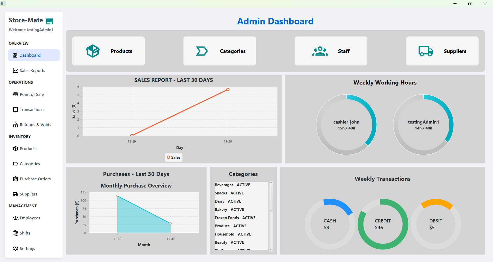       |
| Sales Report | 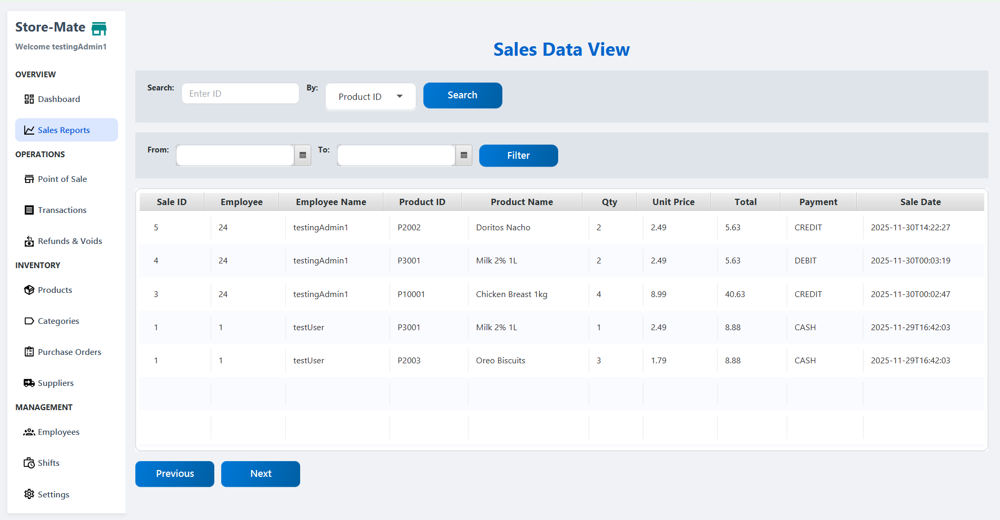 |
| Point of Sales - Sales Mode | 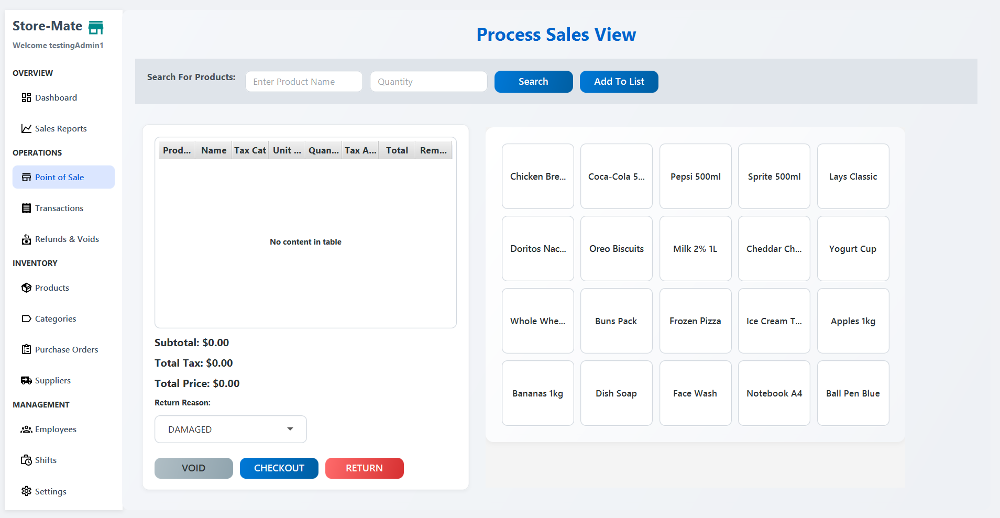             |
| Point of Sales - Returns Mode |            |
| Transactions | 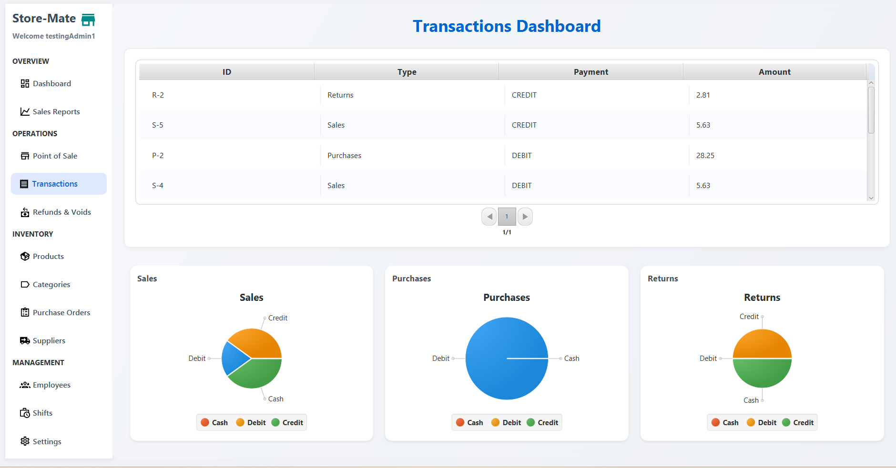 |
| Refunds & Voids | 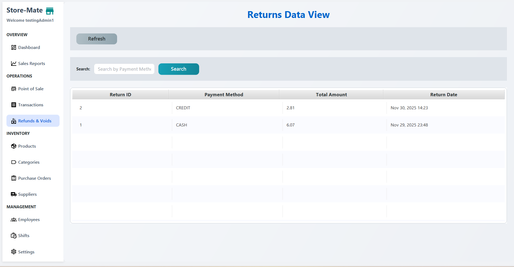           |
| Purchases | 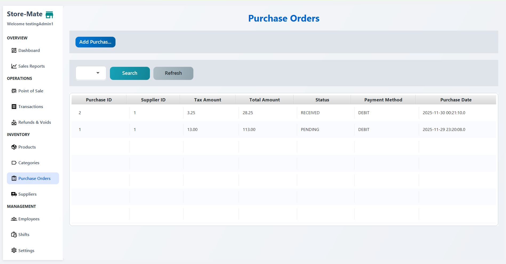       |
| Products (CRUD) | 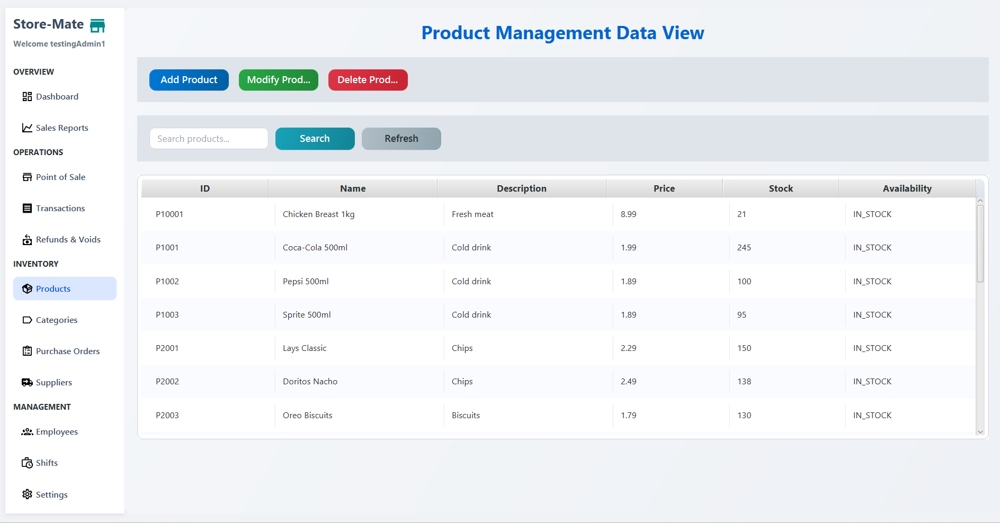         |
| Categories (CRUD) | 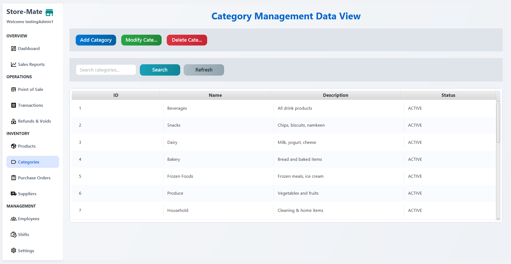     |
| Suppliers (CRUD) | 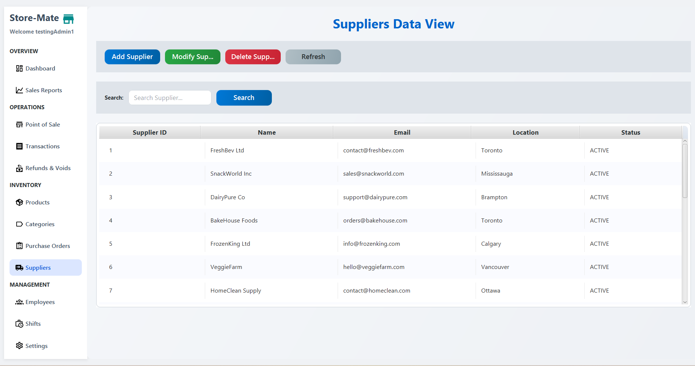       |
| Staff / Employees | 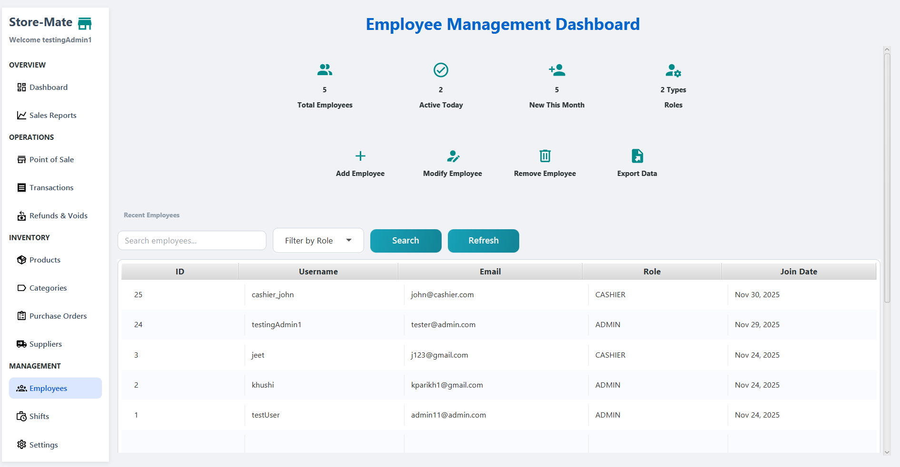               |
| Shifts | 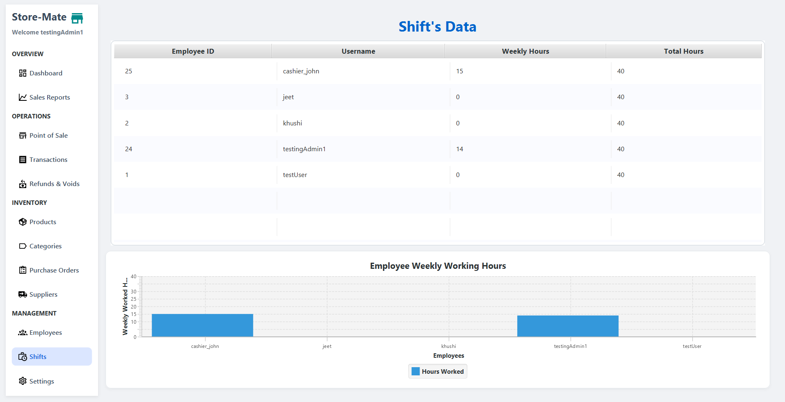              |
| Settings - User Profile | 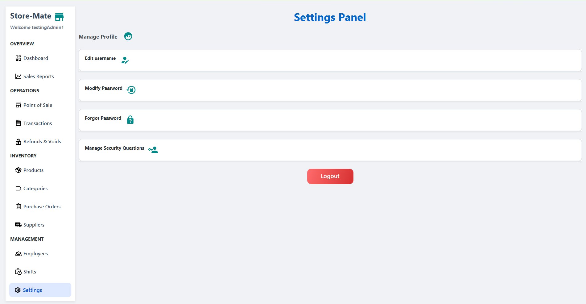         |


## 🛠️ Features

### Dashboard
- Overview of sales, purchases, and recent transactions
- Quick links to POS, reports, and management pages

### Point of Sale (POS)
- **Sales Mode:** Add items, apply discounts, print receipts
- **Returns Mode:** Process returns and voids

### Transactions
- Track all sales and purchase transactions
- Filter by date, staff, or payment type

### Sales Reports
- Daily, weekly, and monthly reports

### Refunds & Voids
- Process refunds and void sales with proper logging

### Purchases
- Place purchase orders to suppliers
- Track incoming stock

### Products, Categories, Suppliers (CRUD)
- Add, edit, delete, and view records
- Search and filter functionality
- Each has child pages for detailed CRUD operations

### Staff / Employees
- Add new staff members
- Assign roles (Admin, Cashier)
- Manage shifts

### Settings
- User Profile: Change username, modify password, set security questions
- Additional settings pages (4 pages in total)

## 🧰 Technologies Used

### **Backend**
- Java 21+
- JavaFX (for desktop UI)
- JDBC + MySQL
- MVC Architecture
- Custom DAO Layer
- Connection Pooling
- Prepared Statements for security

### **Database**
- MySQL
- 18+ relational tables
- Foreign key constraints
- Indexed queries for performance

### **Frontend (JavaFX UI)**
- JavaFX Controls, Layouts, Panes
- CSS-based theming
- Custom components (cards, tables, dialogs)
- Icon libraries (Ikonli / Material Design icons)

### **Tools & Build**
- Maven
- IntelliJ IDEA / VS Code
- Git & GitHub for version control

### **Additional**
- OneDrive-hosted demo video
- Logging & error handling

## ⚙️ Installation & Setup

Follow these steps to run **StoreMate POS** on your local machine.

---

### 1️⃣ Clone the Repository
```bash
git clone https://github.com/jeet7122/Store-Mate.git
cd Store-Mate
```
## 🛠️ Initial Setup (First-Time Use)

When you run **StoreMate POS** for the very first time, the application will automatically detect that no database connection is configured.

You will be shown a **Database Connection Form**, where you must enter your MySQL credentials.

### 🔑 Steps for First-Time Setup

1. **Launch the application**  
   - If no DB configuration exists, the **DB Setup Window** will open automatically.

2. **Enter your database details:**
   - Hostname (e.g., `localhost`)
   - Port (default: `3306`)
   - Username
   - Password
   - Database name (e.g., `storemate_pos`)

3. **Click “Connect”**  
   - If the credentials are valid, the app will establish the connection  
   - Your DB configuration will be saved for future use  
   - You will not need to enter this again

4. **Register your first user**  
   - After DB connection, you will be taken to the **Employee Registration** screen  
   - Create your admin/staff account

5. **Login using your credentials**  
   - Once registered, you can log in and begin using the system

---

### 🧩 After Setup
Once the database connection is stored:

- The app will **skip the DB form automatically** on next launch  
- You can directly log in and use the POS  
- DB settings can be updated later from **Settings → Database Configuration** (if you include this feature)

## 📁 Project Structure
````
Store-Mate/
│
├── src/
│ └── main/
│ ├── java/
│ │ └── org/
│ │ └── storemate/
│ │ └── pos/
│ │ ├── dao/ # Data Access Objects (DB operations)
│ │ │ ├── ProductDAO.java
│ │ │ ├── EmployeeDAO.java
│ │ │ ├── PurchaseDAO.java
│ │ │ └── ...
│ │ │
│ │ ├── database/ # DB connection classes
│ │ │ ├── Config.java
│ │ │ ├── DBConnection.java
│ │ │ └── TableConstants.java
│ │ │
│ │ ├── dto/ # Data Transfer Objects
│ │ │ ├── ProductDTO.java
│ │ │ ├── SecurityQuestionsDTO.java
│ │ │ └── ...
│ │ │
│ │ ├── models/ # POJO models
│ │ │ ├── Product.java
│ │ │ ├── Employee.java
│ │ │ ├── Role.java (enum)
│ │ │ └── ...
│ │ │
│ │ ├── routing/ # Custom navigation system
│ │ │ └── Router.java
│ │ │
│ │ ├── services/ # Business logic
│ │ │ ├── AuthService.java
│ │ │ ├── POSService.java
│ │ │ ├── PurchaseService.java
│ │ │ └── ...
│ │ │
│ │ ├── user_interface/
│ │ │ ├── pages/ # Main application pages
│ │ │ │ ├── DashboardPage.java
│ │ │ │ ├── POSPage.java
│ │ │ │ ├── ReportsPage.java
│ │ │ │ └── ...
│ │ │ │
│ │ │ ├── views/ # Reusable UI components
│ │ │ │ ├── EmployeeRegistrationFormView.java
│ │ │ │ ├── LoginFormView.java
│ │ │ │ ├── TableViewCard.java
│ │ │ │ └── ...
│ │ │ │
│ │ │ └── settingspages/ # Settings subpages
│ │ │ ├── UserProfilePage.java
│ │ │ ├── ChangePasswordPage.java
│ │ │ ├── SecurityQuestionsPage.java
│ │ │ └── ModifyUsername.java
│ │ │
│ │ ├── utils/ # Helpers & utilities
│ │ │ ├── Alerts.java
│ │ │ ├── Session.java
│ │ │ ├── TransitionUtil.java
│ │ │ └── SceneManager.java
│ │ │
│ │ ├── HelloApplication.java # JavaFX main class
│ │ ├── Launcher.java # Fixes runtime issues for JavaFX
│ │ └── module-info.java
│ │
│ └── resources/
│ ├── css/ # Stylesheets
│ ├── audio/ # UI sounds
│ ├── icons/ # Material Icons / Ikonli logo
│ └── assets/ # App images, logos
│
├── .gitignore
└── README.md
````

## 📌 Folder Explanations
### 1️⃣ dao/

Handles all direct database operations (CRUD queries).
Keeps database logic separate from UI and business logic.

### 2️⃣ database/

Contains DB configuration and table constants.
Centralizes all DB connection logic.

### 3️⃣ dto/

Objects used for safe data transfer between layers without exposing raw models.

### 4️⃣ models/

Entity classes (POJOs), mapping to database tables.

### 5️⃣ routing/

Your custom Router that switches pages (since you aren’t using FXML).

### 6️⃣ services/

All business logic (authentication, POS calculations, inventory updates, etc.)

### 7️⃣ user_interface/pages/

Each JavaFX screen (Dashboard, POS, Reports, etc.) lives here.

### 8️⃣ user_interface/views/

Reusable UI components like forms, cards, tables.

### 9️⃣ user_interface/settingspages/

Pages related to user identity, credentials, security questions.

### 🔟 utils/

Reusable helpers for alerts, validation, sessions, music, etc.

### resources/

Images, icons, audio, CSS.

## 🚀 How to Use Store-Mate POS

Once installed and set up, here’s how you can navigate and use the system effectively:

### 1️⃣ Logging In
- Launch the application.
- Enter your **username** and **password** created during the initial setup.
- If credentials are valid, you’ll land on the **Dashboard**.

### 2️⃣ Dashboard Overview
- Quick view of **sales**, **purchases**, and **recent transactions**.
- Access buttons for:
    - POS (Sales / Returns)
    - Reports (Sales, Purchases, Transactions)
    - Staff & Inventory Management

### 3️⃣ Using POS (Point of Sale)
- **Sales Mode**
    - Add products by scanning or selecting from the list.
    - Apply discounts if applicable.
    - Print receipts after completing sales.
- **Returns Mode**
    - Select past transactions.
    - Process returns or void sales.
    - Update inventory automatically.

### 4️⃣ Managing Products, Categories, & Suppliers
- Add, edit, delete records with a simple form.
- Use **search** or **filter** to quickly locate items.
- Detailed CRUD for each entity ensures database integrity.

### 5️⃣ Staff & Roles
- Admins can create, edit, or deactivate staff accounts.
- Assign roles: **Admin**, **Cashier**.
- Track staff shifts and working hours.

### 6️⃣ Reports & Analytics
- Generate **daily, weekly, or monthly sales reports**.
- Filter by **date**, **staff**, or **payment type**.
- Export reports if needed (feature can be added via CSV/PDF).

### 7️⃣ Settings
- **User Profile:** Update username, change password.
- **Security Questions:** Manage recovery options.
- **Database Configuration:** Update credentials if server or DB changes.
- **Audio / Theme Settings:** Customize UI look & feel (if implemented).

---

## ⚙️ Configuration Tips

- Ensure **MySQL server** is running before launching the app.
- Keep **JDBC driver** compatible with your MySQL version.
- Avoid using reserved SQL keywords for **table or column names**.
- Use **UTF-8 encoding** to prevent character issues in product names or customer data.
- For large datasets, enable **indexed queries** in MySQL for faster performance.

---

## 🛡️ Security Notes

- User authentication is role-based; only admins can modify sensitive data.
- Prepared statements are used to prevent SQL injection.
- Passwords should be stored hashed in the database (feature can be added if plain-text currently).

---

## 📝 Contributing

Contributions are welcome! If you want to:

1. Fork the repository.
2. Create a new branch for your feature/fix.
3. Submit a pull request describing your changes.
4. Follow the existing **MVC structure** and coding conventions.

---

## 📜 License

Open Source © 2025 Team Store-Mate  


---

## 💡 Acknowledgments

- [JavaFX](https://openjfx.io/) for desktop UI framework
- [Ikonli](https://kordamp.org/ikonli/) for icons
- Inspiration from small & medium retail POS workflows


